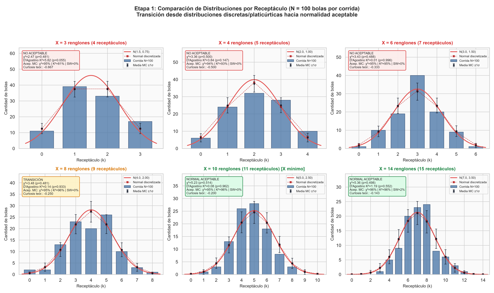
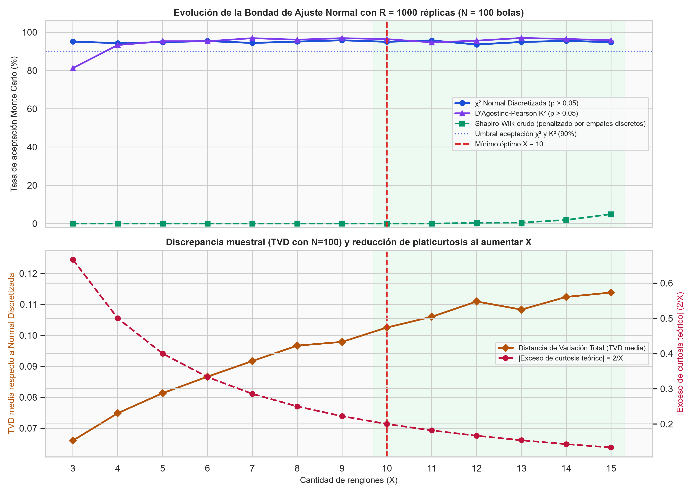
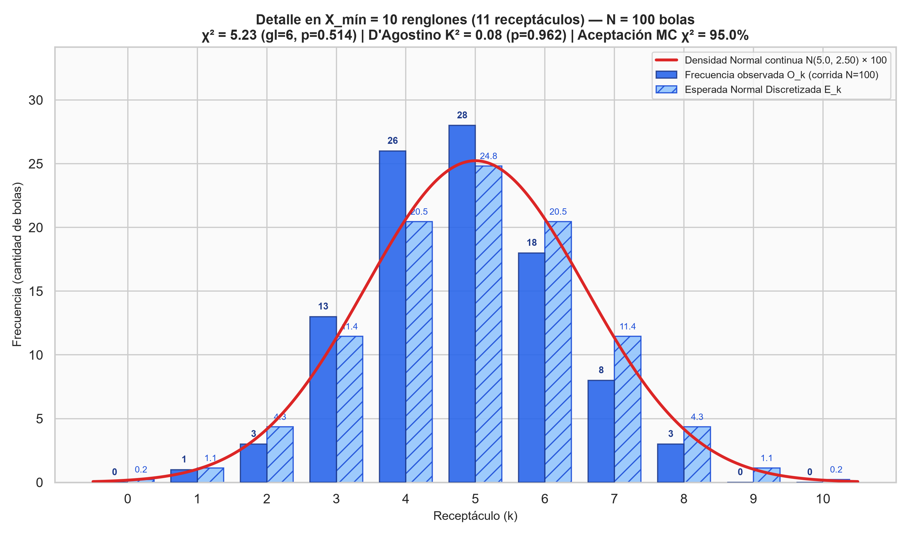
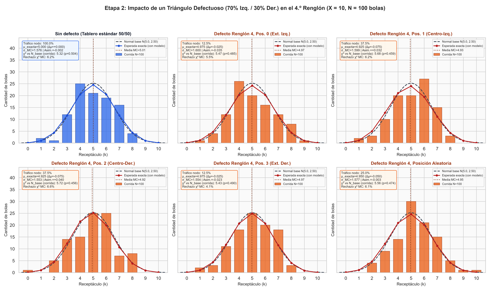
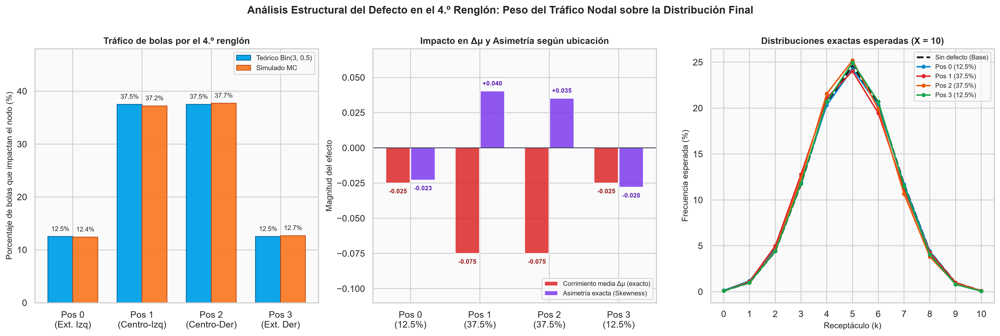

# Trabajo Práctico: Simulación del Tablero de Galton ("Las Copas de Champagne")

**Universidad:** Universidad Nacional de Luján (UNLu)  
**Asignatura:** Modelado, Simulación y Teoría de la Decisión (MSTD)  
**Alumno:** Salvador Baez  
**Fecha:** Noviembre de 2026  

---

## 1. Introducción y planteo del problema

En este trabajo práctico simulamos el experimento conocido como "Las copas de champagne", que corresponde a un Tablero de Galton armado entre dos vidrios. El tablero tiene $X$ renglones horizontales de triángulos clavados (el primer renglón tiene 1 triángulo, el segundo tiene 2, y así hasta llegar al renglón $r$ con $r$ triángulos, numerados de $0$ a $r - 1$ de izquierda a derecha). En la parte inferior hay $X + 1$ copas o receptáculos, numerados desde $0$ hasta $X$.

La idea del experimento es tirar **$N = 100$ bolas** desde arriba, centradas sobre el primer triángulo. En un tablero sano, cada vez que una bola choca contra un triángulo tiene exactamente la misma probabilidad de caer hacia la izquierda (50%) o hacia la derecha (50%). Como cada renglón funciona como tirar una moneda independiente de las anteriores, el número de copa final $K$ en la que termina una bola es simplemente la cantidad de veces que dobló a la derecha a lo largo de $X$ renglones. Por eso, teóricamente, la distribución exacta en un tablero sin fallas sigue una **$\text{Binomial}(X, p = 0.5)$**, con media $\mu = X / 2$ y desvío estándar $\sigma = \sqrt{X} / 2$.

Sabemos por la teoría vista en la materia (Teorema Central del Límite y aproximación de De Moivre-Laplace) que cuando aumentamos la cantidad de renglones $X$, esa distribución Binomial se empieza a parecer cada vez más a la campana de una Distribución Normal. A partir de ahí, el trabajo busca responder dos cosas concretas. Primero, cuál es el mínimo de renglones ($X_{\min}$) necesario para que, tirando 100 bolas, el resultado en las copas ya pueda considerarse una distribución normal aceptable. Segundo, tomando ese tablero mínimo, qué pasa si un único triángulo del 4.º renglón queda defectuoso y pasa a desviar el 70% de las bolas a la izquierda y el 30% a la derecha.

Como una sola tirada de 100 bolas puede variar bastante por pura suerte, repetimos cada escenario **1.000 veces mediante simulación Monte Carlo** (usando un nivel de significancia $\alpha = 0.05$) y además contrastamos los resultados con el cálculo exacto de probabilidades por programación dinámica.

---

## 2. Etapa 1: cantidad mínima de renglones para lograr normalidad

### 2.1 Qué test elegimos y por qué

Cuando empezamos a probar qué test estadístico usar para decidir si las 100 bolas formaban una buena campana normal, nos topamos con un problema bastante claro con Shapiro-Wilk. Aunque suele ser el test más conocido para normalidad, está pensado para variables continuas donde casi nunca se repiten valores exactos. En nuestro tablero, las 100 bolas solo pueden caer en unas pocas copas enteras (entre 4 y 16 según el tablero), lo que genera entre 84% y 96% de valores repetidos. Al correr Shapiro-Wilk directamente sobre esos conteos, rechazaba prácticamente todo (0,0% de aceptación hasta $X = 11$ y apenas 4,9% en $X = 15$), no porque la distribución estuviera mal, sino porque el test no sirve para datos discretos agrupados en pocas categorías.

Por eso elegimos trabajar con el **test Chi-cuadrado ($\chi^2$) de bondad de ajuste**, comparando cuántas bolas cayeron realmente en cada copa contra las que se esperarían de una Normal $\mathcal{N}(X/2, X/4)$ integrada sobre el ancho de cada copa $[k - 0.5 ; k + 0.5]$ (extendiendo los dos extremos hacia el infinito para que la suma esperada dé exactamente 100 bolas). Como en las copas de las puntas caen muy pocas bolas, aplicamos la **regla de Cochran**, que consiste en juntar las copas de los extremos hasta que cada grupo tenga al menos 5 bolas esperadas.

A simple vista uno podría pensar que con Chi-cuadrado ya alcanza, pero mirando qué pasaba con tableros muy chicos vimos que no es suficiente. Con solo 100 bolas, la diferencia entre una Binomial y la Normal discretizada es tan chica que $\chi^2$ acepta el 95,1% de las corridas incluso con $X = 3$ renglones, donde apenas hay 4 copas y la forma es muy chata (curtosis $\gamma_2 = -0.667$), nada que ver con una campana normal. Para evitar quedarnos con un tablero demasiado chico por culpa de eso, pedimos que un tablero cumpla cuatro condiciones juntas para considerarlo aceptable: primero, la regla clásica de De Moivre-Laplace vista en estadística ($X \cdot p \ge 5$ y $X \cdot (1 - p) \ge 5$, que obliga a tener al menos **$X \ge 10$ renglones** y acota el achatamiento a $|\gamma_2| \le 0.20$); segundo, que queden al menos 6 grupos de copas válidos después de agrupar extremos; tercero, que el test $\chi^2$ apruebe al menos el 90% de las 1.000 corridas; y cuarto, que el test de forma D'Agostino-Pearson ($K^2$), que revisa simetría y curtosis juntas, también apruebe al menos el 90%.

### 2.2 Resultados de la simulación entre 3 y 15 renglones

| Renglones ($X$) | Copas | Grupos eff. ($m$) | $\chi^2$ medio | $p$-valor med. ($\chi^2$) | Acep. $\chi^2$ (%) | Acep. $K^2$ (%) | Acep. SW (%) | Curtosis ($\gamma_2$) | Diagnóstico |
|---:|---:|---:|---:|---:|---:|---:|---:|---:|---|
| 3 | 4 | 4 | 3,05 | 0,483 | 95,1% | 81,3% | 0,0% | -0,667 | No aceptable |
| 4 | 5 | 5 | 4,13 | 0,497 | 94,3% | 93,3% | 0,0% | -0,500 | No aceptable |
| 5 | 6 | 4 | 3,05 | 0,482 | 94,8% | 95,3% | 0,0% | -0,400 | No aceptable |
| 6 | 7 | 5 | 4,02 | 0,489 | 95,4% | 95,3% | 0,0% | -0,333 | No aceptable |
| 7 | 8 | 6 | 5,09 | 0,481 | 94,4% | 96,9% | 0,0% | -0,286 | Transición |
| 8 | 9 | 5 | 3,97 | 0,480 | 95,1% | 96,1% | 0,0% | -0,250 | Transición |
| 9 | 10 | 6 | 4,94 | 0,502 | 95,8% | 96,9% | 0,0% | -0,222 | Transición |
| **10** | **11** | **7** | **6,02** | **0,515** | **95,0%** | **96,4%** | **0,0%** | **-0,200** | **Normal aceptable** |
| 11 | 12 | 6 | 4,90 | 0,494 | 95,7% | 94,7% | 0,0% | -0,182 | Normal aceptable |
| 12 | 13 | 7 | 6,36 | 0,451 | 93,6% | 95,6% | 0,4% | -0,167 | Normal aceptable |
| 13 | 14 | 6 | 4,90 | 0,504 | 94,9% | 97,0% | 0,5% | -0,154 | Normal aceptable |
| 14 | 15 | 7 | 5,94 | 0,500 | 95,5% | 96,5% | 1,9% | -0,143 | Normal aceptable |
| 15 | 16 | 8 | 6,92 | 0,501 | 94,8% | 95,8% | 4,9% | -0,133 | Normal aceptable |







### 2.3 Conclusión de la Etapa 1

Con estos criterios, el mínimo necesario para lograr una distribución normal aceptable con 100 bolas es **$X_{\min} = 10$ renglones (11 copas en la base)**. En ese tablero la distribución teórica equivale a $\mathcal{N}(\mu = 5.0, \sigma^2 = 2.50)$, con desvío estándar $\sigma \approx 1.581$. A partir de 10 renglones se cumple la condición de De Moivre-Laplace ($X \cdot p = 5.0 \ge 5$), quedan 7 grupos válidos tras agrupar extremos (6 grados de libertad), la curtosis queda bien acotada ($|\gamma_2| = 0.200$) y los dos tests formales aprueban de forma holgada: 95,0% en $\chi^2$ (con p-valor mediano de 0,515) y 96,4% en D'Agostino-Pearson $K^2$.

---

## 3. Etapa 2: efecto de un triángulo defectuoso en el 4.º renglón

### 3.1 Cuántas bolas pasan por cada triángulo y cuánto se corre la media

Tomando el tablero de 10 renglones que obtuvimos en la primera parte, colocamos un único triángulo defectuoso en el **4.º renglón**. Ese renglón tiene 4 triángulos posibles (posiciones 0, 1, 2 y 3 de izquierda a derecha), y el defecto hace que, en lugar de repartir mitad y mitad, envíe el 70% de las bolas hacia la izquierda y el 30% hacia la derecha.

Lo más interesante de esta segunda parte fue ver cuántas bolas pasan realmente por cada triángulo del cuarto renglón. Antes de llegar ahí, todas las bolas atraviesan los primeros 3 renglones sanos (3 bifurcaciones 50/50), así que el arribo al 4.º renglón sigue una $\text{Binomial}(3, 0.5)$. Eso hace que el tráfico esté repartido de forma muy desigual: por los dos triángulos de los extremos (Posición 0 y Posición 3) pasa apenas 1 de cada 8 bolas, es decir el **12,5%** (en nuestras simulaciones dio 12,40% y 12,68%). En cambio, por los dos triángulos del medio (Posición 1 y Posición 2) pasan 3 de cada 8 bolas, o sea el **37,5%** (37,20% y 37,71% en la simulación), que es exactamente **el triple de bolas**.

Ese detalle explica directo cuánto se corre el promedio ($\Delta\mu$). Una bola que choca con un triángulo normal suma en promedio $+0,50$ hacia la derecha en ese paso, mientras que una que choca con el triángulo fallado suma $+0,30$, dejando una diferencia de $-0,20$ copas. Como los renglones 5 al 10 vuelven a ser simétricos, si el defecto está en los extremos (Posición 0 o Posición 3) la media se corre apenas $\Delta\mu = -0.20 \times 0.125 = \mathbf{-0.025}$ **copas** (pasa de 5,000 a 4,975). Si el defecto está en el centro (Posición 1 o Posición 2), al recibir el triple de bolas la media se corre el triple: $\Delta\mu = -0.20 \times 0.375 = \mathbf{-0.075}$ **copas** (baja a 4,925). Y si en cada corrida el triángulo fallado cae al azar en cualquiera de las 4 posiciones, el corrimiento promedio es de $-0,050$ copas (media de 4,950).

### 3.2 Resultados comparativos de la Etapa 2 ($X = 10, N = 100, R = 1.000$)

| Escenario | Tráfico nodo | Media exacta ($\mu$) | $\Delta\mu$ exacto | Media MC ($\bar{x}$) | Desvío MC ($s$) | Asimetría exacta | $p$-valor med. ($\chi^2$) | Rechazo $\chi^2$ (%) |
|---|---:|---:|---:|---:|---:|---:|---:|---:|
| Sin defecto (Base) | 100,0% | 5,000 | 0,000 | 5,007 | 1,576 | 0,0000 | 0,504 | 6,2% |
| Posición 0 (Ext. Izq.) | 12,5% | 4,975 | -0,025 | 4,974 | 1,600 | -0,0229 | 0,486 | 5,5% |
| Posición 1 (Centro-Izq.) | 37,5% | 4,925 | -0,075 | 4,929 | 1,599 | +0,0403 | 0,457 | 6,2% |
| Posición 2 (Centro-Der.) | 37,5% | 4,925 | -0,075 | 4,923 | 1,553 | +0,0352 | 0,457 | 6,6% |
| Posición 3 (Ext. Der.) | 12,5% | 4,975 | -0,025 | 4,973 | 1,554 | -0,0280 | 0,490 | 4,1% |
| Posición Aleatoria | 25,0% | 4,950 | -0,050 | 4,951 | 1,577 | +0,0063 | 0,474 | 6,1% |





### 3.3 Qué cambia según el lugar del defecto y si se llega a notar con 100 bolas

Mirando la tabla y los gráficos surgen tres conclusiones claras. La primera es la diferencia de tamaño entre poner la falla en el centro o en los bordes: como por Posición 1 y Posición 2 pasa el triple de bolas que por Posición 0 y Posición 3, el desplazamiento de la media es tres veces mayor ($-0,075$ contra $-0,025$) y también baja un poco más el p-valor mediano frente a la campana original (baja de 0,504 a 0,457 en el centro, contra 0,486 y 0,490 en las puntas).

La segunda diferencia tiene que ver con el lado del tablero donde está el defecto y cómo cambia el ancho de la campana. Aunque Posición 0 y Posición 3 corren la media exactamente lo mismo (y lo mismo ocurre entre Posición 1 y Posición 2), su efecto sobre el desvío estándar es opuesto. Cuando el triángulo defectuoso está en la **mitad izquierda (Posición 0 o Posición 1)**, empuja todavía más hacia el borde izquierdo a bolas que ya venían por ese costado, haciendo que la distribución se abra un poco más (el desvío estándar sube de 1,576 a 1,600 en Posición 0 y 1,599 en Posición 1). En cambio, cuando el defecto está en la **mitad derecha (Posición 2 o Posición 3)**, a las bolas que venían yendo hacia la derecha las desvía a la izquierda, devolviéndolas hacia el centro del tablero; eso concentra más la distribución y achica el desvío estándar (baja a 1,553 en Posición 2 y 1,554 en Posición 3).

Por último, nos preguntamos si este defecto se puede detectar mirando una sola tirada de 100 bolas. La respuesta es que **casi no se nota**. Incluso en el peor caso (en el centro, con $\Delta\mu = -0.075$ copas), el corrimiento representa menos del 5% de un desvío estándar (unos $0,047\,\sigma$), que es diminuto frente a la variación normal que tiene tirar 100 bolas al azar. Por eso el test $\chi^2$ contra la distribución normal original sigue rechazando entre 4,1% y 6,6% de las corridas, prácticamente igual que el 6,2% que rechaza cuando el tablero está sano (muy cerca del $\alpha = 5\%$ esperado). En otras palabras, en un único experimento de 100 bolas el ruido del muestreo tapa la falla, y el efecto recién aparece con nitidez cuando promediamos muchas corridas de Monte Carlo o hacemos la cuenta exacta.

---

## 4. Conclusiones generales

A lo largo del trabajo pudimos comprobar en la práctica cómo el Tablero de Galton materializa la convergencia de una distribución Binomial hacia la Normal. Para muestras de 100 bolas, encontramos que el mínimo necesario para hablar de una distribución normal aceptable es de **10 renglones (11 copas)**, punto en el cual se cumplen al mismo tiempo la regla de De Moivre-Laplace ($X \cdot p \ge 5$), una cantidad suficiente de grupos de Cochran ($m = 7$) y tasas de aceptación superiores al 95% en Chi-cuadrado y D'Agostino-Pearson.

También vimos lo importante que es elegir bien la herramienta estadística según la naturaleza de los datos. Aplicar Shapiro-Wilk sobre conteos discretos en copas lleva a rechazar casi todas las muestras por la gran cantidad de empates, mientras que el test $\chi^2$ contra la Normal discretizada (con corrección por continuidad y agrupamiento de colas) evalúa correctamente el ajuste.

En la segunda etapa quedó claro que el impacto de una falla puntual depende tanto del flujo que recibe ese nodo como de su posición respecto al centro: los triángulos centrales del 4.º renglón triplican el efecto sobre la media respecto a los bordes porque reciben el triple de bolas, y además las fallas del lado izquierdo ensanchan la campana mientras que las del lado derecho la comprimen. Sin embargo, con una muestra de apenas 100 bolas en una sola tirada este desvío queda tapado por el azar, mostrando el valor de contar con simulaciones repetidas (Monte Carlo) para detectar anomalías pequeñas en sistemas aleatorios.

---

## 5. Anexo: archivos del proyecto y ejecución

Las simulaciones, los cálculos exactos y los gráficos incluidos en este informe se generaron en Python dentro del proyecto del trabajo práctico. El archivo principal es `main.py` (ejecuta las Etapas 1 y 2 y guarda los gráficos y tablas CSV en `output/`), apoyado por `src/simulator.py` (simulación Monte Carlo y programación dinámica), `src/statistics.py` (tests $\chi^2$, D'Agostino-Pearson y Shapiro-Wilk) y `src/visualization.py` (gráficos). También se incluye el simulador visual interactivo (`demo.py` y `demo_interactiva.html`) y las pruebas unitarias en `tests/test_galton.py`.

```powershell
python -m pytest -v
python main.py
python demo.py
```
