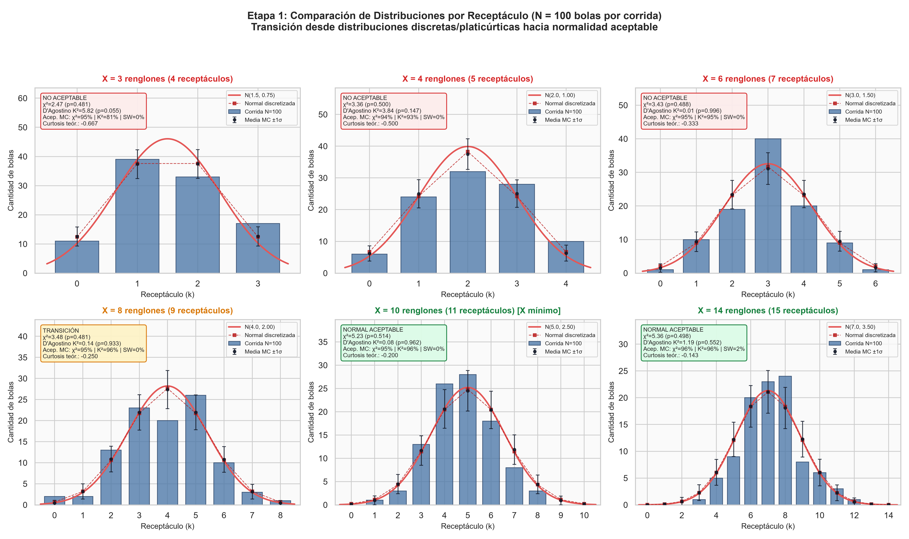
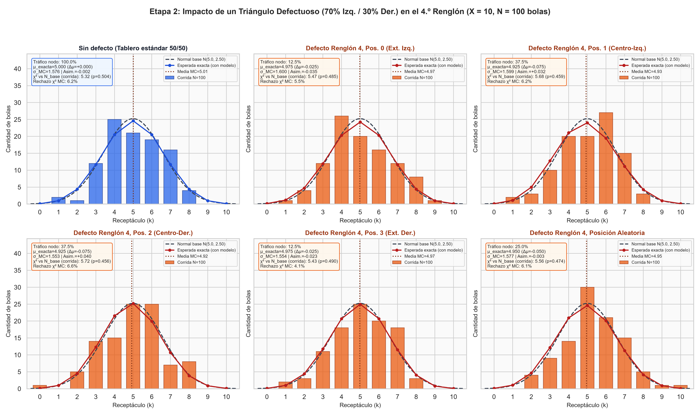

# Las Copas de Champagne — Tablero de Galton (MSTD)

Proyecto de simulación estocástica, inferencia estadística y visualización interactiva para el trabajo práctico **"Las copas de champagne"** de la materia **Modelado, Simulación y Teoría de la Decisión (MSTD)**.

---

## Descripción del Problema

Se modela un Tablero de Galton entre dos vidrios con $X$ renglones de triángulos clavados y $X + 1$ receptáculos ("copas") en la base, lanzando $N = 100$ bolas por corrida desde el centro superior:

1. **Etapa 1 — Mínimo de renglones ($X_{\min}$) para normalidad aceptable:** Determinar el menor número de renglones $X$ tal que la distribución en los receptáculos alcance una normalidad aceptable de manera consistente ($R = 1\,000$ réplicas Monte Carlo de $N = 100$ bolas).
2. **Etapa 2 — Impacto de un triángulo defectuoso en el 4.º renglón:** Analizar cómo cambia la distribución obtenida en $X_{\min}$ cuando un único triángulo del 4.º renglón (posiciones `0`, `1`, `2`, `3` o aleatoria) desvía $70\%$ de las bolas hacia la izquierda y $30\%$ hacia la derecha.

---

## Resultados Principales

### Etapa 1: $X_{\min} = 10$ renglones ($11$ receptáculos)
- **Herramienta estadística:** Test $\chi^2$ de bondad de ajuste contra la **Normal Discretizada** $\mathcal{N}(X/2, X/4)$ con corrección por continuidad $[k - 0.5, k + 0.5]$ y agrupamiento de colas según la **regla de Cochran ($E_i \ge 5$)**, complementado con el test omnibus de forma **D'Agostino-Pearson $K^2$**, mínimo $6$ clases activas y la condición estructural de **De Moivre-Laplace ($X \cdot p \ge 5 \implies X \ge 10$, $|\gamma_2| \le 0.20$)**.
- **Por qué no usar Shapiro-Wilk crudo:** al agrupar $100$ bolas en pocos enteros discretos ($0 \dots X$) existen más del $85\%$ de empates exactos (*ties*), provocando que Shapiro-Wilk crudo rechace casi el $100\%$ ($0.0\%$ hasta $X = 11$).
- **Resultados en $X_{\min} = 10$:** $7$ clases efectivas ($gl = 6$), aceptación $\chi^2 = 95.0\%$ ($p_{\text{med}} = 0.515$), aceptación $K^2 = 96.4\%$ y exceso de curtosis teórico $\gamma_2 = -0.200$.



### Etapa 2: Efecto de la ubicación del defecto en el 4.º renglón ($X = 10$)
El tráfico hacia los $4$ triángulos del 4.º renglón sigue $\text{Binomial}(3, 0.5)$: los extremos (`Pos 0` y `Pos 3`) reciben **$12.5\%$** de las bolas, mientras que los nodos centrales (`Pos 1` y `Pos 2`) reciben **$37.5\%$** (**el triple**).

| Escenario | Tráfico nodo | $\mu$ exacta | $\Delta \mu$ | Desvío MC | Asimetría exacta |
|---|---:|---:|---:|---:|---:|
| Sin defecto (50/50) | 100.0% | 5.000 | 0.000 | 1.576 | 0.0000 |
| Posición 0 (Ext. Izq.) | 12.5% | 4.975 | -0.025 | 1.600 | -0.0229 |
| Posición 1 (Centro-Izq.) | 37.5% | 4.925 | -0.075 | 1.599 | +0.0403 |
| Posición 2 (Centro-Der.) | 37.5% | 4.925 | -0.075 | 1.553 | +0.0352 |
| Posición 3 (Ext. Der.) | 12.5% | 4.975 | -0.025 | 1.554 | -0.0280 |
| Posición Aleatoria | 25.0% | 4.950 | -0.050 | 1.577 | +0.0063 |



---

## Instalación y Uso

1. **Instalar dependencias:**
   ```bash
   pip install -r requirements.txt
   ```

2. **Ejecutar simulación completa y generar gráficos/tablas en `/output`:**
   ```bash
   python main.py
   ```

3. **Abrir la vista gráfica y demo animada en vivo:**
   ```bash
   python demo.py
   ```
   *(También podés abrir directamente `demo_interactiva.html` en cualquier navegador, 100% offline).*

4. **Ejecutar pruebas unitarias:**
   ```bash
   python -m pytest -v
   ```

---

## Estructura del Repositorio

| Ruta | Descripción |
|---|---|
| [`main.py`](main.py) | Script principal que ejecuta ambas etapas, imprime tablas y exporta gráficos PNG (300 DPI) y CSV |
| [`demo.py`](demo.py) | Lanzador de la aplicación visual interactiva |
| [`demo_interactiva.html`](demo_interactiva.html) | Simulador físico animado en vivo con estética *dark-champagne* y gráficos en tiempo real |
| [`src/simulator.py`](src/simulator.py) | Motor Monte Carlo vectorizado y programación dinámica exacta |
| [`src/statistics.py`](src/statistics.py) | Normal discretizada, test $\chi^2$ con agrupamiento de Cochran, D'Agostino $K^2$ y Shapiro-Wilk |
| [`src/visualization.py`](src/visualization.py) | Generación de los 5 gráficos comparativos de alta resolución |
| [`tests/test_galton.py`](tests/test_galton.py) | Suite de 7 pruebas unitarias |
| [`INFORME_TECNICO.md`](INFORME_TECNICO.md) | Informe técnico formal con el desarrollo estadístico y conclusiones |
| [`output/`](output/) | Gráficos PNG (300 DPI) y tablas resumen CSV de Etapa 1 y Etapa 2 |
